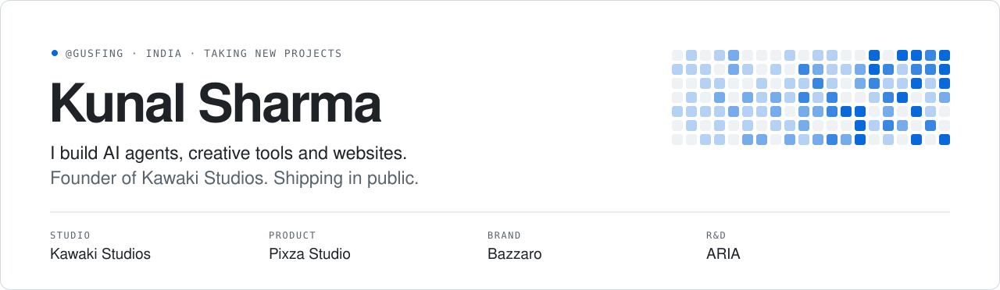
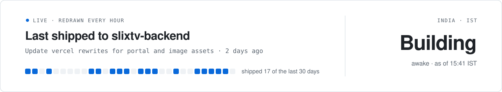
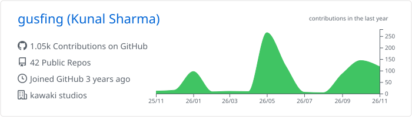
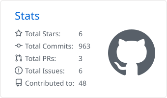
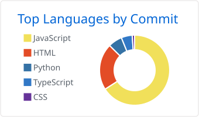

<picture>
  <source media="(prefers-color-scheme: dark)" srcset="./assets/header-dark.svg" />
  
</picture>

<picture>
  <source media="(prefers-color-scheme: dark)" srcset="https://raw.githubusercontent.com/gusfing/gusfing/live/live-dark.svg" />
  
</picture>

 

I run **Kawaki Studios**, a small digital agency in India, and use the cashflow to build my own products. Most of what I make sits where AI meets creative work: agents that write code, tools that edit video, pipelines that generate images. I ship small, ship often, and post the process — wins and misses — as I go.

 

### Now

| Venture | What it is | Status |
|:--|:--|:--|
| **Kawaki Studios** | Agency — web, SEO, automation and custom AI for clients | Active |
| **Pixza Studio** | Node-based editor for AI image, 3D, audio and video pipelines | [Building in public](https://github.com/gusfing/pixza_ai) |
| **Bazzaro** | Fashion label; every product asset is generated in Pixza | [bazzaro.in](https://bazzaro.in) |
| **ARIA** | A voice-first AI assistant for Windows, with local-model fallback | In development |

 

### Selected work

| Project | What it does | Stack |
|:--|:--|:--|
| [**Kova AI**](https://github.com/gusfing/kova-ai) | Autonomous website architect. Drives Claude Code, Codex and local models with a live Next.js preview. | JavaScript |
| [**Cutlass**](https://github.com/gusfing/opensubtitle) | Free, local AI caption studio with animated styles and proper Hindi support. | Rust · Tauri |
| [**Video Editor V1**](https://github.com/gusfing/video-editor-v1-skill) | Claude Code skill that cuts raw talking-head footage into documentary-style edits. | Python |
| [**Agent Orchestrator**](https://github.com/gusfing/agent-orchestrator) | Protocol that makes coding agents plan, delegate and review their own work. | Markdown |
| [**Debate Reasoning**](https://github.com/gusfing/debate-reasoning) | Multi-agent adversarial debate for hard engineering calls. | Markdown |
| [**VaidyaLink**](https://github.com/gusfing/VaidyaLink) | Turns handwritten medical records into interoperable digital health data. | Python · AWS |

 

### Recognition

**Finalist** — GUVI AI Summit Hackathon 2026, for an [AI honeypot](https://github.com/gusfing/HoneypotAPI-) that engages scammers and extracts fraud signals. 
**Semi-finalist** — AWS Hackathon, for [VaidyaLink](https://github.com/gusfing/VaidyaLink), pitched to an Amazon technical panel.

 

### Activity

<picture>
  <source media="(prefers-color-scheme: dark)" srcset="./profile-summary-card-output/github_dark/0-profile-details.svg" />
  
</picture>

<picture>
  <source media="(prefers-color-scheme: dark)" srcset="./profile-summary-card-output/github_dark/3-stats.svg" />
  
</picture>
<picture>
  <source media="(prefers-color-scheme: dark)" srcset="./profile-summary-card-output/github_dark/2-most-commit-language.svg" />
  
</picture>

<picture>
  <source media="(prefers-color-scheme: dark)" srcset="https://raw.githubusercontent.com/gusfing/gusfing/output/github-contribution-grid-snake-dark.svg" />
  
</picture>

 

### Elsewhere

[Instagram](https://www.instagram.com/unscripteddayswithkunal/) &nbsp;·&nbsp; [YouTube](https://www.youtube.com/@kunalbuildAi) &nbsp;·&nbsp; [X](https://x.com/Kunalsharmadec6) &nbsp;·&nbsp; [LinkedIn](https://www.linkedin.com/in/kunalsharmaai/) &nbsp;·&nbsp; [kawaki.co.in](https://kawaki.co.in/)

Daily builds under <i>One Problem, One App</i>. No investors, no co-founder — just shipping.
